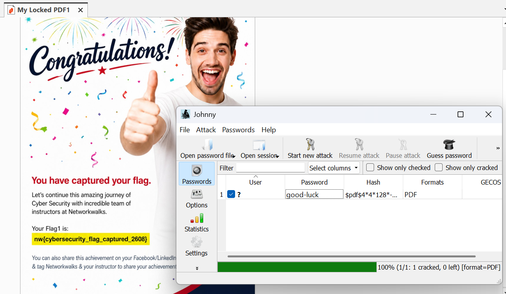
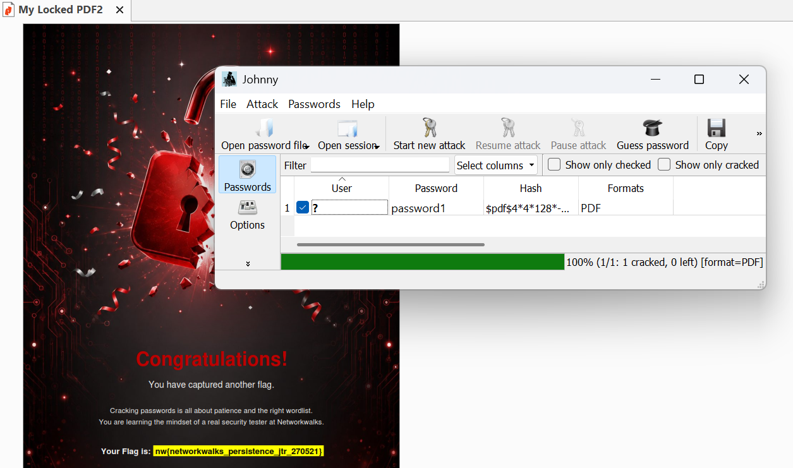
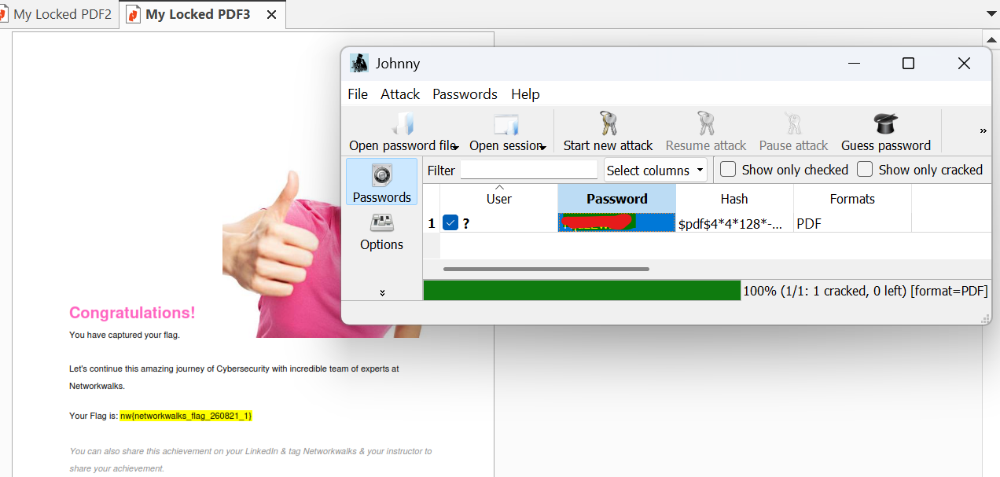

# Week-3-Password-Cracking-with-John-the-Ripper-JTR-

**Cybersecurity & Ethical Hacking Internship | Networkwalks**  
**Project:** Week 3, Project Module 1  
**Participant:** Ezekiel Arom  
**Environment:** Windows PC  
**Tools:** John the Ripper (JTR), Johnny GUI, PDF hash extraction utility, text editor, PDF reader

> **Ethical-use notice:** This exercise was performed on the provided training PDFs. Only test files that you own or have explicit permission to assess. Do not upload confidential documents to third-party hash extraction services.

## 1. Project overview

The objective of this hands-on exercise was to assess password protection on supplied PDF challenge files using **John the Ripper** and its graphical front end, **Johnny**. The official Networkwalks Week 3 guide focuses on `My Locked PDF1.pdf`; this submission also documents the two additional challenges visible in my evidence screenshots (`My Locked PDF2` and `My Locked PDF3`).

John the Ripper is a password-auditing tool that tests candidate passwords against extracted password-verification data. Johnny provides a GUI for importing hashes, starting attacks, and reviewing recovered passwords.

## 2. Learning objectives

- Install and configure John the Ripper and Johnny on Windows.
- Extract password-verification data from an authorized, password-protected PDF.
- Import a PDF hash into Johnny and perform an offline password audit.
- Verify recovered passwords by opening the challenge PDFs.
- Record evidence and interpret the security implications of weak passwords.

## 3. Tools and resources

| Tool | Purpose |
| --- | --- |
| John the Ripper | Offline password recovery / password-strength auditing |
| Johnny GUI | Graphical interface for managing JTR attacks |
| PDF hash extractor | Converts an authorized PDF into a JTR-compatible hash record |
| Notepad | Saves extracted hash data as a plain-text file |
| PDF reader | Confirms whether a recovered password opens the file |

**Official resources:** [John the Ripper](https://www.openwall.com/john/) · [Johnny GUI](https://openwall.info/wiki/john/johnny)

The Networkwalks training guide demonstrates a web-based PDF hash extractor. For sensitive or non-public files, use a **local** extractor (such as `pdf2john`) instead of uploading a PDF to an external website.

## 4. Lab procedure

### Step 1 — Install and configure the tools

1. Download John the Ripper from the official Openwall website.
2. Download and install Johnny GUI.
3. Open Johnny, select **Settings**, and browse to the John the Ripper executable (`john.exe`) in the extracted JTR `run` folder, as illustrated in the guide.
4. Confirm Johnny is configured to invoke John the Ripper.

### Step 2 — Prepare the PDF hash

1. Obtain the authorized password-protected challenge PDF.
2. Extract its PDF password-verification hash using an appropriate extractor. The supplied guide demonstrates an online PDF hash extractor; a local tool is preferable when handling sensitive files.
3. Copy the extracted record into Notepad and save it as `hash1.txt` (use distinct filenames for additional challenges).
4. Ensure the extracted hash has the expected PDF format, commonly beginning with `$pdf$`, and remove any accidental text wrappers introduced during copying.

**Important:** A PDF hash record is not the plaintext password. The recovery process tests candidate passwords against the record.

### Step 3 — Load and audit the hash in Johnny

1. In Johnny, select **Open password file**.
2. Browse to the saved hash text file.
3. Select **Start new attack** to begin the authorized password audit.
4. Wait for the run to complete and review the **Password** column and progress indicator.
5. Record the result, then verify it by opening the corresponding PDF with the recovered password.

The screenshots supplied with this submission show **100% (1/1: 1 cracked, 0 left)** for each of the three challenges. They establish the final outcome, but do not establish the precise attack mode, wordlist, or elapsed time used.

## 5. Results and evidence

| Challenge | Password shown in Johnny | Status | Evidence |
| --- | --- | --- | --- |
| My Locked PDF1 | `good-luck` | 1/1 recovered; flag visible | [Screenshot 1](screenshots/Flag1.png) |
| My Locked PDF2 | `password1` | 1/1 recovered; flag visible | [Screenshot 2](screenshots/flag2.png) |
| My Locked PDF3 | Redacted in screenshot | 1/1 recovered; flag visible | [Screenshot 3](screenshots/flg3.png) |

### Challenge 1 — My Locked PDF1



**Observed password:** `good-luck`  
**Observed completion:** 100%, one recovered entry  
**Captured flag:** `nw{cybersecurity_flag_captured_2608}`

The screenshot shows Johnny displaying the recovered password and the PDF displaying the congratulatory flag page.

### Challenge 2 — My Locked PDF2



**Observed password:** `password1`  
**Observed completion:** 100%, one recovered entry  
**Captured flag:** `nw{networkwalks_persistence_jtr_270521}`

The screenshot shows the recovered password in Johnny and a second flag page displayed in the PDF reader.

### Challenge 3 — My Locked PDF3



**Observed password:** Not disclosed; the password cell is visually covered in the screenshot.  
**Observed completion:** 100%, one recovered entry  
**Captured flag:** `nw{networkwalks_flag_260821_1}`

The evidence supports successful recovery and access to the challenge PDF, but **does not support reporting the third plaintext password**.

## 6. Technical discussion

### Password protection and offline guessing

A password-protected PDF stores cryptographic parameters and password-verification information that an authorized auditor can extract. John the Ripper can test candidate passwords offline. Weak, common, or predictable passwords may be found quickly, while stronger and more unpredictable passwords generally increase the effort required.

### Encryption versus hashing

Encryption protects document content and is reversible with the appropriate key. Hashing is a one-way transformation. In this lab, the extracted PDF hash-like record was used for password verification; recovering a password is **not** the same as reversing a cryptographic hash.

### Security implications

The first two recovered passwords illustrate why predictable or commonly used passwords are unsuitable for protecting sensitive documents. The screenshots demonstrate successful recovery in this controlled lab; they do not by themselves measure the time or computing resources needed for a broader attack.

## 7. Challenges and lessons learned

- Correctly configuring the Johnny GUI to use the JTR executable is an essential setup step.
- A valid, correctly formatted PDF hash record is required before the audit can begin.
- The GUI provides a convenient way to observe recovery progress and results.
- Successful recovery should be verified against the original authorized challenge file.
- Screenshots should distinguish what is **observed** from what is **inferred**; the third password remains undisclosed in the supplied evidence.

## 8. Recommendations

1. Use long, unique, randomly generated passwords or strong passphrases for protected documents.
2. Avoid common strings, simple patterns, and password reuse.
3. Use up-to-date PDF encryption settings supported by the intended recipients.
4. Share document passwords through a separate secure channel.
5. Keep confidential PDFs and extracted hash material out of public repositories.
6. Conduct password auditing only within an approved scope and securely remove temporary sensitive artifacts when finished.

## 9. Repository structure

```text
Week3_JTR_GitHub/
├── README.md
└── screenshots/
    ├── Flag1.png
    ├── flag2.png
    └── flg3.png
```

The repository includes the README and three proof-of-completion screenshots. It intentionally does not include the original locked PDFs or extracted password hashes.

## 10. Conclusion

The three provided screenshots document successful completion of the Networkwalks Week 3 PDF password-recovery challenges using Johnny / John the Ripper. All three show one recovered entry out of one. The first two passwords are visible (`good-luck` and `password1`), while the third password is obscured. The exercise reinforces practical understanding of PDF password auditing, evidence-based reporting, and the risks of weak passwords.

## 11. References

- Networkwalks. *Week 3 | Project Module 1: Password Cracking with JTR.* Supplied 15-page training guide.
- Openwall. [John the Ripper password cracker](https://www.openwall.com/john/).
- Openwall Wiki. [Johnny — GUI for John the Ripper](https://openwall.info/wiki/john/johnny).

---

*Prepared by Ezekiel Arom | Networkwalks Cybersecurity & Ethical Hacking Internship*
